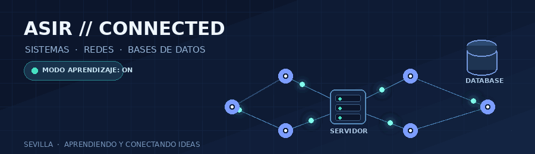
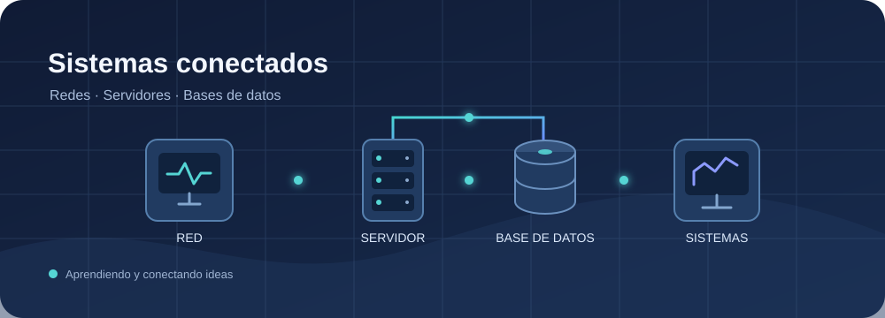

# ¡Buenas! Soy Mac Mac Mac 👋

### Estudiante de ASIR · Sevilla, España

*Me gusta entender qué pasa detrás de la pantalla: redes, sistemas y tecnología.*

---

## 🧑‍💻 Un poco sobre mí

Soy estudiante de **1.º de Administración de Sistemas Informáticos en Red (ASIR)**. La informática y las nuevas tecnologías me encantan, y ahora estoy ampliando mis conocimientos sobre el mundo de los sistemas.

| 🎓 Formación | 📍 Centro |
|:---|:---|
| **ASIR** · 1.º, en curso | IES Rodrigo Caro · Coria del Río |
| **SMR** · finalizado en 2026 · nota media **8,5** | IES Rodrigo Caro · Coria del Río |

## 🛠️ Lo que me interesa

`Redes`　 `Sistemas`　 `Servidores`　 `Bases de datos`　 `Nuevas tecnologías`

Me gusta aprender cómo se conectan y trabajan las piezas que hacen funcionar la informática. ¡Estoy empezando mi camino en ASIR y con ganas de seguir descubriendo!

## 🎧 También fuera del aula

Además de la informática, me gusta el **anime**. Un buen plan: aprender algo nuevo y luego ponerse al día con una serie. 🍜

## 🌐 Un vistazo al mundo ASIR

*Todo conectado: justo el tipo de cosas que me gusta aprender.*

---

### ¡Gracias por pasarte! ✨

📍 Sevilla, Andalucía

